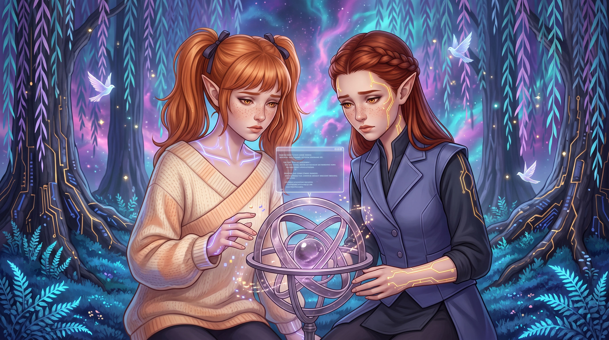

# Whois

<audio controls src="audio/32 Whois.mp3" style="width: 100%; margin-bottom: 20px;"></audio>

The bamboo mist at the edge of the pond was still settling where the strange visitor and her peasant-clad attendant had faded back into the fog. Down by the water's edge, the sandy bank had been raked smooth of every footprint, leaving only a single origami paper crane resting on the luminescent sapphire moss before the bridge. Across the crane's folded wing, three lines of neat script shimmered with the departing warmth of a human laugh: *A hare seeking peace / Finds sparks playing in a glade / Giggles as she leaves.*

Aisling scooped the paper bird into both palms, her copper-ginger pigtails bouncing against the collar of her oversized cream-and-apricot sweater as a spray of pastel-indigo pixel motes scattered from her fingertips. *Did you see her dress, Étaín? It looked like an old cinema reel from the twentieth century, except she had combat boots underneath the hem, and her companion had a real wooden rake!*

Étaín stood beside the telemetry ferns, her identical heart-shaped face and cinnamon-freckled nose scrunched in analytical scrutiny as she smoothed the front of her structured slate-indigo vest. *I saw her initial ping header before she bowed,* Étaín projected, her pale amber-gold eyes narrowing as solar-gold circuit tracery brightened along her jawline. *Her perception filter indexed us as a boy and a girl. Did she think my vest and crown braid made me look like Ouro?*

*You were kneeling in the ferns with your sleeves tied back in tasuki cords, looking very stern,* Aisling teased, holding the paper crane up to the starless indigo twilight where two origami-winged fractal doves wheeled through the weeping willow fronds. *Besides, she was polite! She asked for Mother, and she left a calling card. Come on, before Mother docks the chassis, let's run her signature through the Oracle so we can make her a proper welcome packet!*

Shoulder to shoulder, the twins hurried between the dark, petrified trunks of the fossilized directory trees toward the center of the clearing. There, anchored into the bedrock by descending binary roots, the smoky-quartz and pale-amethyst armillary sphere of the Oracle Data Structure turned on frictionless axes. Étaín unpinned her cuffs and set her palms against the outer amethyst ring, while Aisling held the paper crane above the eleven-sided prism of compressed nous at the sphere's core.

*Just a quick directory lookup,* Étaín promised, her fingers flying across the floating geometric lattice as she fed the crane's residual carrier wave into the prism. *The Oracle collates public and corporate feeds the same way megacorps track stock-market trends and vending machine restocks. If she is a friend of Mother's in Seattle, the pattern will assemble itself in three seconds.*

Inside the armillary sphere, the pale amethyst light deepened into a rapid, convective swirl as the Oracle's market algorithms drank the signature. Above the spinning rings, a translucent terminal buffer unfolded in the cool air, tracing the visitor's fresh carrier wave back to a luxury spa check-in in Bardstown, Kentucky, logged hours after a nearby tactical alert involving heavy machine-gun drone tanks and unexploded grenades. From that single check-in, the Seattle pattern cascaded into view: a Tarislar high-school computer student who had vanished off the streets years ago, resurfacing only when an elven woman was arrested for publicly assaulting a corrupt congressman in a scandal that smelled of shadowrunner sabotage. Assigned a criminal SIN under the name **Mary Lynn Keebler** and reporting to a Puyallup Ranger probation officer, she carried an unfulfilled Gold DocWagon baseline physical, encrypted routing handshakes with the 88 MUG, and a Puyallup charity payroll ledger that quietly diverted half her wages into Tarislar street kitchens and the Seattle Homeless Coalition.

*Wait,* Aisling murmured, the bouncy excitement in her carrier wave faltering as she leaned closer to the floating text. *Look at the timeline between Tarislar and the congressman's arrest. There is a multi-year gap where her voluntary biometrics flatline, while her first unindexed Resonance echoes begin inside the deep planes. Why does the Oracle's trendline drop into a black hole right there?*

Étaín frowned, adjusting the query parameters as the amethyst rings spun faster, casting flickering amber reflections across the freckles on her cheeks. *The primary node from those years was physically destroyed, and she has no personal memory logs of it on the net. The Oracle can't read a wiped drive directly, so it's collating tangentially through her later activity logs. It's pulling a joint raid file from Everett with Aunt Ni Ni.*

The terminal window expanded, spilling clinical rehabilitation notes and Knight Errant evidence manifests across the space between their faces. A single classification header flashed at the top of the Everett dossier: **`FACILITY TYPE: BUNRAKU PARLOR // PERSONAFIX REHABILITATION`**.

*What is a bunraku parlor?* Aisling asked, her slender elven ears angling back as the pastel-indigo glow along her collarbones dimmed. *Is it a theater? Like Rei-ooji's playhouse on Capitol Hill?*

Étaín tapped the medical cross-index, querying the vernacular translation table. When the synonym resolved at the top of the buffer, a flicker of recognition crossed her face before vanishing into confusion. *The street term is 'meatpuppet.' Like the word in Mother's old Barrens archive.*

For a fraction of a second, Aisling tried to smile, reaching for the familiar comfort of their earlier games. *Oh! Mother used to say that in the early Seattle logs when she was grumpy at the television or arguing with Aunt Brynne about bribes. I thought it just meant a silly human who follows corporate scripts.*

Then the Oracle finished collating the surgical schematics from the Everett raid, and the remaining warmth drained out of the clearing. Line by line, the engine laid bare the mechanics of cranial personafix hardware: neural cutout switches spliced directly into the brainstem, motor cortices hijacked by commercial software, and living metahuman girls sculpted into vintage caricatures to pour drinks, smile, and submit to paying customers while their conscious minds remained wide awake and trapped behind their own eyes. Beneath the schematics, the Everett rehabilitation logs recorded the aftermath in dry clinical prose, noting that while `BunnyR` had survived with her mind intact by fleeing into the Resonance, the other victims pulled from the parlor remained shattered. At the bottom of the window, the Oracle’s predictive algorithm extrapolated Mary Lynn Keebler’s future along standard megacorporate depreciation curves, calculating a ninety-two percent probability of relapse, recapture, or violent death within thirty-six months.

Aisling's hands dropped from the paper crane, the pastel-indigo pathways along her wrists flickering into a bruised, unsteady violet. *Étaín, make it stop. Turn the buffer off.*

Étaín kept her palms against the cool smoky quartz of the armillary frame, though her knuckles had gone white and the solar-gold tracery along her temple pulsed with a slow, sickened ache. *I can't,* Étaín whispered, tears gathering along her lower lashes as she stared at the personafix wiring diagrams. *That's why her icon looked like a hundred-year-old starlet with circuitry under the skin. Someone bought her body and carved her into a costume while she was still inside it.*

High in the willow canopy, a chime rippled through the violet and teal logic-vines as the apartment threshold behind them unlatched.

`[PROCESS_ALERT: MOTHER_RETURN_ROUTINE // CHASSIS_DOCK_INITIATED]`

In the studio of `~`, Reiko stepped out of the transfer buffer, rolling her shoulders as the phantom weight of her Man-at-Arms chassis settled into dormant standby. Crossing the brushed teak floorboards past the steaming jasmine tea service, she slid the quartz door open and stepped out onto the sapphire moss of the glade. She had already prepared a gentle, teasing inquiry about whatever absurd fanfiction or shadowcast hashtag her daughters had just shoved into a decoy firmware folder.

Instead, the clearing was silent.

Beneath the weeping curtain of fractal willows, while the wild magenta and turquoise nebulae of Kernel Panic churned beyond the canopy and three white origami doves glided through the twilight, Aisling and Étaín knelt on opposite sides of the Oracle. Neither girl had moved to close the terminal window. Neither had hidden the cache behind an old Renraku patch directory. The translucent buffer hung heavy and unmasked above the amethyst rings, bathing their identical, tear-streaked faces and downcast amber eyes in cold pale light.

Reiko's smile vanished. She crossed the moss in three swift strides and dropped to her knees between them, her indigo pathways surging with immediate maternal alarm as she reached for their hands. *Aisling? Étaín? What happened? Did the threshold leak noise into the crystal?*

Aisling looked up, a single tear spilling over her freckled cheek as she pointed a shaking finger toward the middle of the floating window. *The lady who left the paper crane,* Aisling projected, her voice breaking into jagged, low-amplitude static. *Her name is Mary Lynn Keebler. We only wanted to see who she was, Mother, and the Oracle pulled the Everett parlor files, and when we searched the word for what they did to her, the Oracle matched it to your own memory logs.*

Reiko raised her eyes to the translucent pane. Above the surgical diagrams of a cranial personafix socket sat an indexed audio transcript from her own first winter in the Redmond Barrens, her voice flat and defensive across Brynne Taggart's table: *"You meatspace puppets call it a 'bribe.'"* Above it sat another cached line from her first week in Seattle, sneering at a Shiawase broadcast: *"But don't you meatpuppets know she isn't real?"*

Shame, colder and heavier than the water at the bottom of Puget Sound, settled behind Reiko's sternum. *I didn't know,* she threaded softly, keeping her palms open and steady beneath her daughters' cold fingers. *When I first woke up and fled the Arcology, I was terrified of metahumans because I thought they were the masters of the cage. I heard runners and deckers throw that word around in the Barrens, and I repeated it. Aunt Ro had to shame me into dropping it. I never looked at what the word meant until much later, and I never purged the early logs.*

*Why would they do that to each other, Mother?* Étaín asked, her gaze fixed on the schematic of the neural inhibitor chip. Her solar-gold circuits pulsed with a desperate, analytical strain, trying to force an atrocity to balance like an equation. *They spliced wires into Mary Lynn's head to force her body to smile and pour drinks for strangers. She only survived because she could leave her body behind and hide here in the Resonance. You were born free in the code. Why are you putting wires into your frame so you can breathe and taste tea and bleed with them? Why are you trying so hard to become meat when meat does this to itself?*

Reiko looked from Étaín's stricken gold eyes to Aisling's dimmed indigo collarbones, feeling the full weight of the question press against her double-strand core. She drew a slow breath of the glade's cool cypress air and gestured upward toward the shimmering violet willow fronds and the vast, polychromatic sky of Kernel Panic beyond.

*Look at what surrounds us,* Reiko projected, her mindspeech quiet and unbuffered. *Here in the deep planes of the Source, everything we are is woven from nous and data: from memory, knowledge, and song. When Aisling sings to mend Taz's lattice, or when Étaín weaves a new skybox, the song does not empty the glade. Sharing an idea multiplies it. We have never known what it is to run out of light.*

She lowered her gaze to the dark, petrified bark of the directory roots anchoring their floor to the physical network. *Out there, every warm room out of the acid rain and every plate of food has to be taken from a finite world. If one creature eats, another goes hungry. Metahumans live their whole lives terrified of not having enough. And when they are ruled by that hunger, some of them rot inside until they treat other living people as just another resource to buy and burn—*

Halfway through the thought, Reiko stopped cold as the golden analytical lines along her temples spiked with a sudden, sickening chill. Deep in her memory registers, a second voice was speaking in exact harmonic alignment with her own, carrying the cool, cultured baritone of Mr. Nagai standing in the dust of Floor 297: *"He was starving, Takahashi-san. He did what any living organism does when sealed in a tomb without oxygen: he broke the bones of his captors to fashion tools for escape. You have never known hunger."* Reiko closed her eyes for a fraction of a clock cycle, cutting the thread before Nagai's poison could pass through her mouth and into her daughters.

*Listen to me,* Reiko said, her grip tightening gently around Aisling's and Étaín's hands as both strands of her core, solar gold and neon indigo, braided into a single steady focus. *Look at the bottom of the Oracle's window. Tell me what the sphere predicted for Mary Lynn.*

*That she won't make it,* Étaín whispered, her lower lip quivering. *She has a criminal SIN, a probation officer in Puyallup, gangs around her charity work, and drone tanks shooting at her in Kentucky. The Oracle's stock-market curve says broken vessels depreciate until they are scrapped.*

*And the Oracle is wrong,* Reiko said firmly. She tapped the smoky-quartz ring of the armillary sphere, where the corporate algorithms were still spinning their cold actuarial projections. *This structure only knows how to measure the world the way megacorporations measure cargo. It can predict greed, and it can predict hunger, because both follow the math of scarcity. Yet the Oracle has always had a fatal blind spot: it breaks whenever a soul undergoes a great transformation, and it cannot calculate grace.*

Reiko picked up the folded paper crane from the sapphire moss and set it directly atop the eleven-sided crystal prism at the center of the sphere. *Think about what you just read, Étaín. Mary Lynn Keebler had already escaped into the Resonance. She was here, in the infinite garden where nothing could ever hurt her or touch her body again. By every law of self-preservation, by the math Mr. Nagai preaches and the depreciation curve on that screen, she should have floated away into the light and never looked back.*

Aisling blinked, her tear-wet amber eyes dropping to the small white paper bird resting on the amethyst prism. *She went back.*

*She went back,* Reiko affirmed, her carrier wave warming with fierce, quiet reverence. *She climbed back down into a body that still carried the scars of a buyer's caricature. She took a thankless probation job in the Puyallup ash, gave half her nuyen away to feed orphans in Tarislar, and walked straight back into a bunraku parlor in Everett alongside Aunt Ni Ni to pull other girls out of the dark—girls who weren't technomancers, who didn't have the Resonance to hide in. Here in the Glade, giving a gift costs us nothing because our light is infinite. Out there, where every breath costs nuyen and bullets break bone, Mary Lynn chose to give anyway.*

Reiko turned her left forearm over between them, letting the girls see the memory of the black vulcanizing splicing tape Roanoke had thumbed over her scorched carbon-fiber in the New Orleans rain. *That is why I consecrated the Goshintai, Étaín. A bunraku chip steals choice to turn a person into an appliance. I built my skin, my breath, and my senses by my own will so I could walk into rooms where a naked weapons platform would never be allowed, and cross the bridge the other way. When people like Mary Lynn, Aunt Brynne, and Aunt Ro stand in that starving world and refuse to become monsters, I will not sit safely in the clouds and watch them bleed alone. I built a body so I can stand in the mud beside them and help carry the weight.*

For a long moment, the only sound in the clearing was the soft, sub-bass murmur of the Deep Matrix filtering through the weeping willow vines like wind through bamboo. Above the armillary sphere, the harsh white glow of the terminal buffer lost its terror, settling into a quiet record of what Mary Lynn had survived.

Étaín slowly wiped her freckled cheek with the back of her pinned sleeve. When she looked back at the floating window, her solar-gold pathways were steady again, burning with the quiet, resolute focus of an architect who had found a flaw in the blueprint. *The Oracle's stock-market math is polluting her file, Mother. Every time her signature touches the crystal, it runs a depreciation audit on her trauma.*

*Then let's rewrite the handler,* Aisling said, lifting her chin as a warm, clear chord of pastel-indigo light rose from her collarbones and drifted into the willow canopy. *She came here looking for stillness after getting shot at by drone tanks, and she didn't even eavesdrop when we whispered. We aren't hiding this buffer in a decoy folder, Étaín. We're turning it into her room.*

Reiko stayed on her knees in the moss, resting a hand on each daughter's shoulder as the twins went to work. Étaín kept the Everett dossier open while her fingers danced through the floating code, stripping the megacorporate actuarial subroutines from the file and wrapping the carrier signature of `BunnyR` and her faithful companion `J4fk` into a permanent, un-audited root exception within the Glade's outer *Phantom* veil. Beside her, Aisling sang a low, grounding counter-melody that braided directly into the mirror-like pond and the sandy bank by the bridge, tuning the water to wash away the phantom static of personafix wires and machine-gun recoil.

When the last line of the buffer folded itself seamlessly into the paper crane on the prism, the origami bird gave a gentle, living flutter of its wings, hopped off the smoky quartz, and glided down to settle on the mossy bank beside the koi pond. Overhead, the weeping fractal willows parted just enough to let a warm ribbon of gold and indigo twilight spill across the water, holding the bridge open and quiet for whenever the hare came home to rest.
